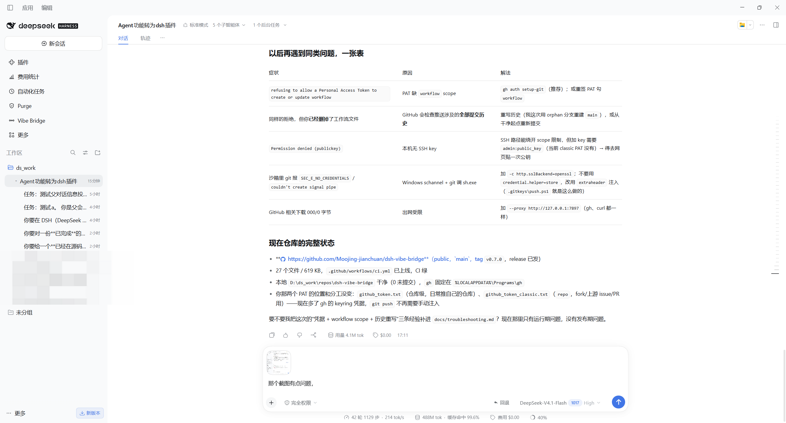
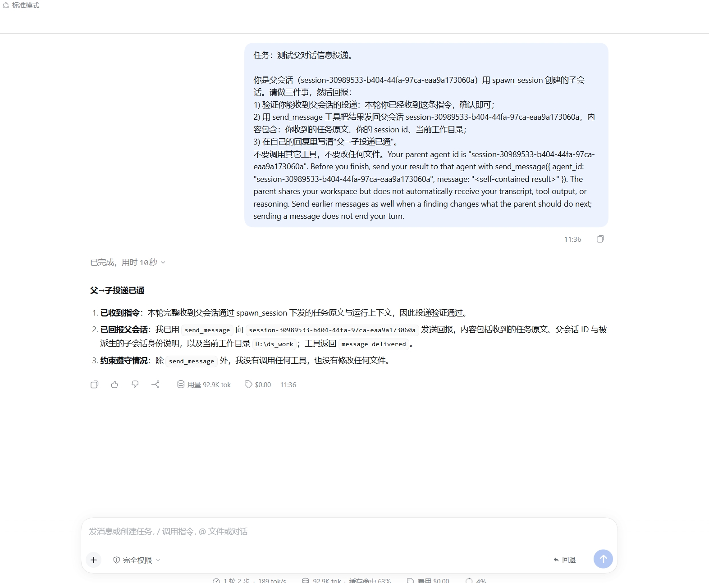
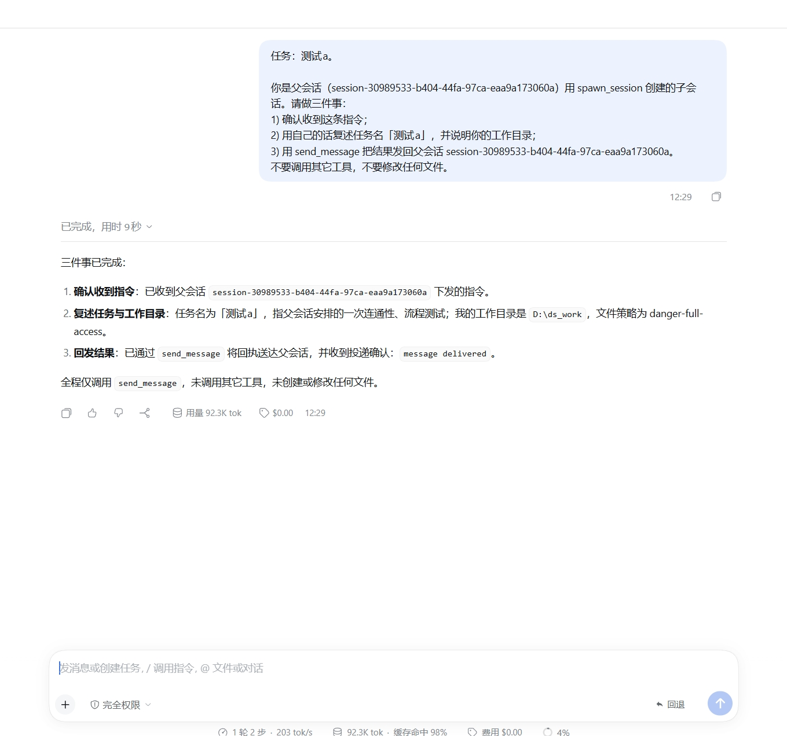

# dsh-vibe-bridge

**English** · [中文说明](README.zh.md)

A plugin for [DeepSeek Harness](https://github.com/deepseek-ai/deepseek-harness) (DSH) that closes the gaps around **parent/child sessions**: children you can create without spending a model turn, a parent that can read what a child actually did, and a sidebar where the relationship is visible.

> Session lineage is a first-class idea in DSH — a parent spawns children through the `subagent` tool — but the surrounding ergonomics are thin: a child's session id never reaches the parent, the sidebar hides subagent rows by design, and there is no cheap way to ask "what did that child produce?". This plugin adds those pieces **as a Cordis plugin**, with one optional build-level enhancement for the native sidebar.



## What it looks like

A parent session, its children one indent step in, each parent carrying its own fold toggle (`▾` expanded / `▸` folded). The `Vibe Bridge` entry in the left rail opens the scheduler page: a live session tree, a *Create child session* form, and the nudge rules currently in force.

Children are real sessions: click one to open its own conversation, and the parent keeps a one-line notice with that child's session id when it finishes — no extra `list_sessions` hop needed.

### Detail: what a child session actually receives

The task text arrives verbatim as the child's first user message — no wrapper prompt asking some other model turn to spawn it. This child was created from the sidebar; it confirms delivery in 14 seconds and reports back with `send_message`:



The second one shows the round trip the parent cares about: the child restates the task, states its working directory, and sends the result back to the parent's session id — all in one turn, with the tool call visible in the transcript:



## Features

| # | Feature | How it works | Needs the optional patch? |
|---|---|---|---|
| 1 | **Child sessions you can create directly** — right-click a session → *Create child session*, or `/vibe-spawn label\|task`, or the plugin's own panel | registers a host command (`ctx.commands.register`) and starts the activation; the child's first message is your task text, not a wrapper prompt | no |
| 2 | **Parent gets the child id** — one notice per completed child, batched, carrying session id + status | `subagents.startActivation` with `delivery: "caller"`, then `agent.followup`; a debounce window merges children that finish together | no |
| 3 | **`query_session`** — read another session's recent rounds from its persisted log | streams the JSONL session log, replays its multi-frame zstd, renders rounds + tool summary | no |
| 4 | **`post_to_session` / `stop_session` / `list_sessions`** | thin, consistent wrappers over the subagent service with parent/child role checks | no |
| 5 | **Turn-cadence prompt nudges** (碎碎念) | `agent/pre-step` injects a reminder at chosen turns; the text is re-read from disk each time; identical repeats collapse to a one-line marker | no |
| 6 | **Wake state survives restarts** | `<DSH_HOME>/vibe-bridge/wake-state.json`, atomic writes, 12 h TTL, compensation on startup | no |
| 7 | **Nested, collapsible child rows in the *native* sidebar** | source patch against `ui-workspace` + your own build of that package | **yes** (experimental, version-bound) |

Everything except #7 is a normal DSH plugin: install it, enable it in `cordis.patch.yml`, done. #7 rewrites one built client bundle, so it binds to a specific DSH build — see [Optional: child rows in the native sidebar](#optional-child-rows-in-the-native-sidebar).

## Install the plugin

```bash
# 1) point the plugin at your DSH install once, so tests and install can resolve @deepseek-ai/*
node tools/dev-link.mjs --dsh "/path/to/dsh"          # macOS/Linux: the .app Resources dir
#    or: --dsh-node-modules "/path/to/dsh/node_modules"

# 2) run the contract tests (they exercise the real service shapes)
npm test

# 3) install into a DSH profile (idempotent; --uninstall to remove)
node tools/install.mjs --profile desktop --dsh "/path/to/dsh"
```

`tools/install.mjs` copies the package into `<DSH_HOME>/profiles/<profile>/node_modules/dsh-vibe-bridge`, links its `@deepseek-ai` dependencies to your DSH installation (so both halves share one module instance), runs the smoke tests **in place**, and appends the `cordis.patch.yml` entry. Restart DSH for the host half, refresh the page for the client half.

Windows note: linking uses a directory junction, so no admin rights and no developer mode are required.

## Configuration

The plugin reads its config from the profile's `cordis.patch.yml`:

```yaml
- insert:
    - id: vibe-bridge
      name: 'dsh-vibe-bridge'
      config:
        enabled: true
        provider: spawn          # spawn = fresh context, fork = inherit the parent's finished rounds
        wakeParentOnChildFinish: true
        wakeDebounceMs: 800      # merge children that finish within this window into one notice
        persistWakeState: true   # survive restarts
        announceChildId: true    # tell the child its own session id
        rules:
          - name: verify
            file: '/abs/path/to/nudge.md'   # re-read every turn, so edits apply immediately
            everyTurns: 4                   # sparse reminder cadence
            fullEveryTurns: 12              # full text cadence
            fromTurn: 1
            skipSubagentSessions: true
            speakOnFirstSeen: true
```

| Key | Default | Meaning |
|---|---|---|
| `rules[].text` / `rules[].file` | — | inline text or a path re-read per turn |
| `rules[].sparseText` | first N lines | what the sparse cadence sends |
| `rules[].everyTurns` / `fullEveryTurns` | 1 / 0 | cadence; `0` disables the full pass |
| `wakeDebounceMs` | 800 | batch window for completion notices |
| `persistWakeState` | `true` | write `wake-state.json` and compensate on restart |
| `enableSpawn` / `enableQuery` / `enablePost` / `enableList` / `enableStop` | `true` | per-tool switches |

## Tools

| Tool | Model-visible contract |
|---|---|
| `spawn_session(prompt, label?, cwd?)` | starts a child; returns `session started: <childSessionId>` |
| `post_to_session(session_id, message, stop_current?)` | delivers a message to a session; prefixes `[来自会话 <id> 的消息]`; `stop_current` interrupts a running target first (direct children only) |
| `list_sessions()` | all sessions with `{id, label, status, role: parent\|child}` |
| `query_session(session_id, tail?, include_tools?, verbose?)` | header + the last `tail` rounds; `verbose` adds model/provider/workdir and longer excerpts |
| `stop_session(session_id)` | interrupts a direct child only |
| `vibe_bridge_status()` | live status, rule list, injected count **and injected characters** |

The host command `/vibe-spawn <label>|<task>` backs the UI's *Create child session* action, so creating a child never costs a parent model turn.

## What it costs in context

Measured on a 19-turn parent session (model-visible `content` text only, not the duplicated `source.sections` copy):

| Item | Before 0.6.0 | After |
|---|---|---|
| Injected nudge messages | 12 | 12 (cadence unchanged) |
| Injected characters | 2,501 | ~1.2 k expected — identical repeats collapse to a marker |
| Share of user-side content | **54 %** | roughly halved |
| `query_session` report | 938 chars (verbose shape) | 818 chars default, **938** with `verbose: true` |
| Child-done notices (5 children) | 5 messages | **1** batched message |
| `announceChildId` | 180 chars | 96 chars |

Nudges remain **visible user messages** on purpose: moving them into the system prompt would be cheaper but would turn a visible reminder into an invisible rule.

## Optional: child rows in the native sidebar

DSH hides `origin: 'subagent'` rows on purpose and exposes no "row" slot — the four slots it declares inside the session list are `menu.item`, `row.action`, `row.leading`, `row.hover`. So a pure plugin cannot add rows; this is the one thing that needs a source change.

```bash
# 1) a DSH source checkout at the pinned tag
git clone --depth 1 --branch dsh-v0.2.1-rc.5 https://github.com/deepseek-ai/deepseek-harness.git
cd deepseek-harness

# 2) apply the patch and build the workspace client bundle
git apply -p1 /path/to/dsh-vibe-bridge/tools/source-patch/nested-sessions.patch
pnpm install
pnpm run build:artifacts

# 3) install that one bundle into your DSH, keeping the shipped one as a backup
node /path/to/dsh-vibe-bridge/tools/install-bundle.mjs \
  --bundle packages/client/ui-workspace/lib/client.js \
  --dsh-node-modules "/path/to/dsh/node_modules"

# undo at any time
node /path/to/dsh-vibe-bridge/tools/install-bundle.mjs --restore --dsh-node-modules "…"
```

What the patch implements (7 source files, 3 test files, plus README and its i18n record):

- child rows render indented under their parent, titled by the live session title → catalog label → id short form;
- a per-parent fold toggle keyed `session:<parentId>`, **expanded by default**, accessible name from the locale dictionary;
- child rows take no watermark slot and cannot be dragged;
- **child rows carry exactly one row verb — archive or restore** — through its own list slot (`sidebar.workspaces.session.childRow.action`). They render no menu, so rename, pin, and fork never target them, and the ordinary row-action list stays off them so a pin entry cannot reach a row it cannot pin. Archiving a running child still routes through the Host's stop-and-archive confirmation;
- the archive filter applies to them exactly as to parents, with one deliberate exception: the *archived only* view still lists an archived parent's archived children, because that view is where archived sessions are recovered;
- selecting a child keeps its parent inside the watermark even while collapsed.

Verified against the tag: `pnpm run typecheck` (5 gates), `pnpm run build:artifacts` (7 gates, 327 client artifacts), `vitest` in `packages/client/ui-workspace` (**495 tests**), per-file coverage **100 %** for `tree.ts / stores.ts / Rows.tsx / locales.ts`, `verify-client-ui-i18n`, `verify-export-jsdoc`, `verify-md-wrap`, `verify-translation-pairing`.

> **This half is experimental and version-bound.** It patches a built artifact and touches internal shapes. A DSH upgrade can invalidate it; when that happens the plugin keeps working (features 1–6) and only the nested native rows fall back to the plugin's own panel tree. `tools/legacy-dist-patch.mjs` is the older, purely textual variant of the same idea, kept for reference; it refuses to run once a source build is installed.

## Compatibility

| Component | Version |
|---|---|
| DSH | `0.2.1-rc.5` (the source patch is generated against `dsh-v0.2.1-rc.5`) |
| Node | `>= 22.19` |
| OS | Windows, macOS, Linux (the sidebar bundle installer uses junctions on Windows, symlinks elsewhere) |

Upgrading DSH: re-run `tools/install.mjs` (plugin half is version-agnostic until a service shape changes — the contract tests tell you), then rebuild and re-apply the source patch if you use the sidebar enhancement. If the patch no longer applies, open an issue with your DSH version; the diff is small and cheap to rebase.

## Limitations

- **No row slot** — that is the whole reason for the source patch. Any claim that native nested rows can be done by a plugin alone is wrong.
- **`query_session` reads logs, not memory** — it needs a persisted session log; an unflushed running turn shows whatever the log already holds.
- **Wake compensation infers termination** — after a restart the plugin sees "the child is no longer running", not its real stop reason; a child killed while DSH was down is reported as finished.
- **Child rows only list `continuable` children** — `external` (one-shot ACP) children have no resumable session to open.
- **`test:gui` in a DSH checkout** is red on Windows for reasons unrelated to this plugin (`ui-deliverables` needs symlink privileges; two other specs are flaky under parallel load). See [docs/troubleshooting.md](docs/troubleshooting.md).

## Uninstall

```bash
node tools/install.mjs --uninstall --profile desktop
node tools/install-bundle.mjs --restore --dsh-node-modules "/path/to/dsh/node_modules"
```

## Repository layout

```
lib/index.js                 host half: tools, nudges, wake notices, wake-state
lib/client.js                client half: sidebar entry, panel tree, create-child dialog
lib/nudge.md                 default nudge text (re-read per turn)
test/                        host contract (25), client contract (16), wake-state probe (4)
tools/install.mjs            install into a profile (idempotent, runs the tests in place)
tools/install-bundle.mjs     install/restore the optional sidebar bundle
tools/dev-link.mjs           link @deepseek-ai/* from your DSH for local tests
tools/source-patch/          the diff against DSH `ui-workspace`
tools/legacy-dist-patch.mjs  retired textual patcher (reference only)
docs/                        screenshots, troubleshooting, maintenance notes
```

## License

MIT — see [LICENSE](LICENSE). Discusses DSH compatibility; DSH itself is MIT-licensed and not redistributed here (no DSH source files or build artifacts are committed). See [NOTICE](NOTICE).
