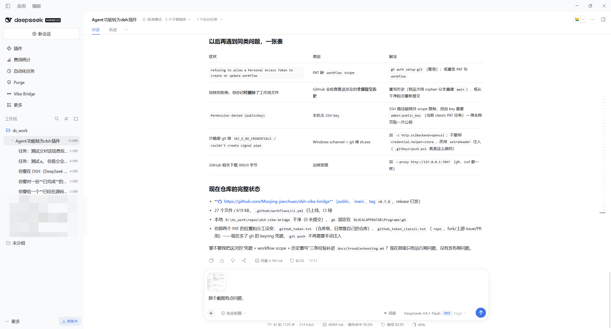
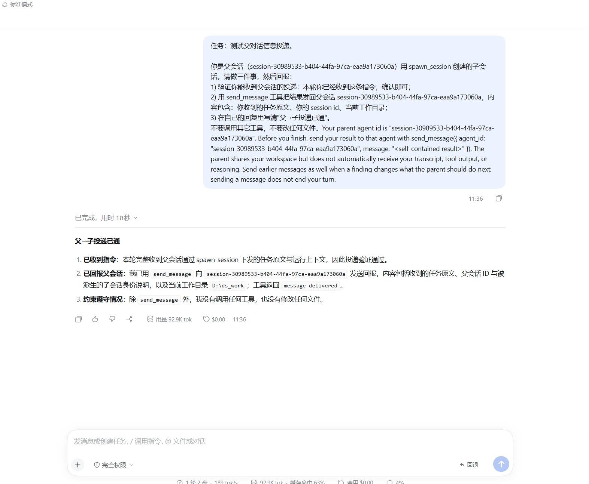
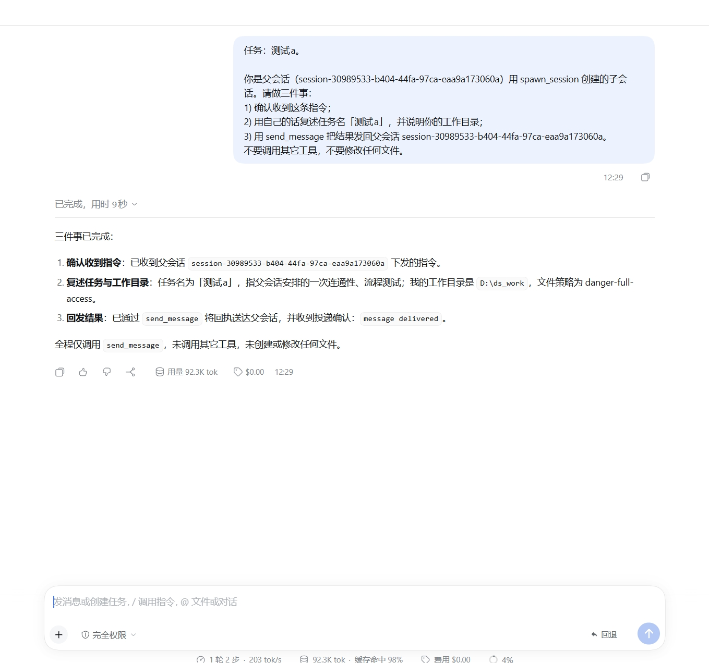

# dsh-vibe-bridge

**English** · [中文说明](README.zh.md)

A plugin for [DeepSeek Harness](https://github.com/deepseek-ai/deepseek-harness) (DSH) that closes the gaps around **parent/child sessions**: children you can create without spending a model turn, a parent that can read what a child actually did, and a sidebar where the relationship is visible.

> Session lineage is a first-class idea in DSH — a parent spawns children through the `subagent` tool — but the surrounding ergonomics are thin: a child's session id never reaches the parent, the sidebar hides subagent rows by design, and there is no cheap way to ask "what did that child produce?". This plugin adds those pieces **as a Cordis plugin**, with one optional build-level enhancement for the native sidebar.



## What it looks like

A parent session, its children one indent step in, each parent carrying its own fold toggle (`▾` expanded / `▸` folded). The `Vibe Bridge` entry in the left rail opens the scheduler page: a live session tree, a *Create child session* form, and the nudge rules currently in force.

Children are real sessions: click one to open its own conversation, and the parent keeps a one-line notice with that child's session id when it finishes — no extra `list_sessions` hop needed.

### Detail: what a child session actually receives

The task text arrives verbatim as the child's first user message — no wrapper prompt asking some other model turn to spawn it. This child was created from the sidebar; it confirms delivery in 14 seconds and reports back with `send_message`:



The second one shows the round trip the parent cares about: the child restates the task, states its working directory, and sends the result back to the parent's session id — all in one turn, with the tool call visible in the transcript:



## Features

| # | Feature | How it works | Needs the optional patch? |
|---|---|---|---|
| 1 | **Child sessions you can create directly** — right-click a session → *Create child session*, or `/vibe-spawn label\|task`, or the plugin's own panel | registers a host command (`ctx.commands.register`) and starts the activation; the child's first message is your task text, not a wrapper prompt | no |
| 2 | **Parent gets the child id** — one notice per **assigned** run, batched, carrying session id + status | `subagents.startActivation` with `delivery: "caller"`, then `agent.followup`; a debounce window merges children that finish together. A child run counts as assigned when this plugin started it or the parent messaged it (`post_to_session`); your own turns inside the child never notify the parent | no |
| 3 | **`query_session`** — read another session's recent rounds from its persisted log | streams the JSONL session log, replays its multi-frame zstd, renders rounds + tool summary | no |
| 4 | **`post_to_session` / `stop_session` / `list_sessions`** | thin, consistent wrappers over the subagent service, with a pre-flight **communication matrix** (own child ✅ · parent↔parent ✅ · another parent's child ❌ · sibling ❌ · own parent ✅) and `notify: 'once' \| 'never'` (subscribe to one receipt, or deliver without any notice); `list_sessions(scope: 'workspace')` reads every persisted session with its `parent_id`/`workdir` | no |
| 5 | **Delivery is visible and auditable** — `[inject]` blocks in `query_session`, three-state inbox replay (`queued`/`consumed`/`dropped`) and a `get_session_inbox` queue view | replays `agent/inbox/spliced` from the session log; no new event, no host change | no |
| 6 | **Turn-cadence prompt nudges** (碎碎念) | `agent/pre-step` injects a reminder at chosen turns; the text is re-read from disk each time; identical repeats collapse to a one-line marker | no |
| 7 | **Wake state survives restarts** | `<DSH_HOME>/vibe-bridge/wake-state.json`, atomic writes, 12 h TTL, compensation on startup | no |
| 8 | **Nested, collapsible child rows in the *native* sidebar** | source patch against `ui-workspace` + your own build of that package | **yes** (experimental, version-bound) |

Everything except #8 is a normal DSH plugin: install it, enable it in `cordis.patch.yml`, done. #8 rewrites one built client bundle, so it binds to a specific DSH build — see [Optional: child rows in the native sidebar](#optional-child-rows-in-the-native-sidebar).

### Which runs notify the parent

A child gives the parent a notice only when the parent asked for that run:

| Who started the child's turn | Notice? |
|---|---|
| this plugin (`spawn_session`, the *Create child session* dialog, `/vibe-spawn`) | yes — once, when that activation settles; worded as **work you assigned** |
| the parent messaging it again (`post_to_session`, `notify: 'once'` — the default) | yes — once per message: the plugin re-arms the child, so the first settle after the message reports back; worded as a **subscription receipt** |
| the parent messaging it with `post_to_session({ notify: 'never' })` | **no** — delivered without arming, so that message never produces a notice |
| you, typing in the child's own conversation | **no** — the child is not armed, so the parent is left alone |
| the child continuing work on its own after a notice | no |

That is the `armed` flag in `wake-state.json`: it is set when the plugin spawns a child or the parent posts to it, cleared when the notice is queued, and it is what a restart compensates for. So opening a child and chatting with it does not spam its parent, while a task you actually assigned always comes back with its session id. The **reason** (`spawn` or `post`) is persisted next to that flag too, so a notice restored after a restart is still worded correctly.

## Install the plugin

```bash
# 1) point the plugin at your DSH install once, so tests and install can resolve @deepseek-ai/*
node tools/dev-link.mjs --dsh "/path/to/dsh"          # macOS/Linux: the .app Resources dir
#    or: --dsh-node-modules "/path/to/dsh/node_modules"

# 2) run the contract tests (they exercise the real service shapes)
npm test

# 3) install into a DSH profile (idempotent; --uninstall to remove)
node tools/install.mjs --profile desktop --dsh "/path/to/dsh"
```

`tools/install.mjs` registers the package in the profile and links its `@deepseek-ai` dependencies to your DSH installation (so both halves share one module instance), runs the smoke tests **in place**, and appends the `cordis.patch.yml` entry. Restart DSH for the host half, refresh the page for the client half.

**Let the profile's package manager own the package.** A pnpm-managed profile prunes anything its `package.json` does not declare, so a hand-copied `node_modules/dsh-vibe-bridge` silently disappears the next time DSH (or its plugin manager) reinstalls — the plugin then stops loading and its sidebar entry, right-click menu and tools all vanish at once. `tools/install.mjs` therefore adds a `link:<this repo>` dependency through the profile's own pnpm when the profile has a manifest, and only falls back to copying for a manifest-less profile.

Windows note: linking uses a directory junction, so no admin rights and no developer mode are required.

## Configuration

The plugin reads its config from the profile's `cordis.patch.yml`:

```yaml
- insert:
    - id: vibe-bridge
      name: 'dsh-vibe-bridge'
      config:
        enabled: true
        provider: spawn          # spawn = fresh context, fork = inherit the parent's finished rounds
        wakeParentOnChildFinish: true
        wakeDebounceMs: 800      # merge children that finish within this window into one notice
        persistWakeState: true   # survive restarts
        announceChildId: true    # tell the child its own session id
        rules:
          - name: verify
            file: '/abs/path/to/nudge.md'   # re-read every turn, so edits apply immediately
            everyTurns: 4                   # sparse reminder cadence
            fullEveryTurns: 12              # full text cadence
            fromTurn: 1
            skipSubagentSessions: true
            speakOnFirstSeen: true
```

| Key | Default | Meaning |
|---|---|---|
| `rules[].text` / `rules[].file` | — | inline text or a path re-read per turn |
| `rules[].sparseText` | first N lines | what the sparse cadence sends |
| `rules[].everyTurns` / `fullEveryTurns` | 1 / 0 | cadence; `0` disables the full pass |
| `wakeDebounceMs` | 800 | batch window for completion notices |
| `persistWakeState` | `true` | write `wake-state.json` and compensate on restart |
| `enableSpawn` / `enableQuery` / `enablePost` / `enableList` / `enableStop` | `true` | per-tool switches |
| `enableInbox` | `true` | register `get_session_inbox` |
| `enableCrossParent` | `true` | allow `post_to_session({ cross_parent: true })` (the session-controller fallback) |

## Tools

| Tool | Model-visible contract |
|---|---|
| `spawn_session(prompt, label?, cwd?)` | starts a child; returns `session started: <childSessionId>` |
| `post_to_session(session_id, message, stop_current?, cross_parent?, notify?)` | delivers a message to a session, but only where the communication matrix allows it (own child / own parent / parent↔parent); prefixes `[来自会话 <id> 的消息]`; `stop_current` interrupts a running target first (direct children only); `cross_parent` is a parent↔parent switch only (top-level targets); `notify` (default `'once'`) subscribes the target's next settle as a **subscription receipt**, `'never'` delivers without subscribing; returns `{messageId, via, notify}`; another parent's child or a sibling is refused before anything is sent |
| `list_sessions(scope?)` | `scope: 'children'` (default) → `{id, label, status, role: parent\|child}`; `scope: 'workspace'` → every session in the session store with `{id, label, status, origin, parent_id?, workdir, workspace}` |
| `query_session(session_id, tail?, include_tools?, verbose?)` | header + the last `tail` rounds, including an `[inject]` section for messages other sessions injected; `verbose` adds model/provider/workdir and longer excerpts |
| `get_session_inbox(session_id)` | what is still queued in another session's inbox: `{position, target, source_kind, sender_session_id?, queued_at, preview}` |
| `stop_session(session_id)` | interrupts a direct child only |
| `vibe_bridge_status()` | live status, rule list, injected count **and injected characters** |

The host command `/vibe-spawn <label>|<task>` backs the UI's *Create child session* action, so creating a child never costs a parent model turn.

## Delivery visibility: injects, three states, who-may-message-whom, notices, workspace scope

DSH writes every inbox mutation to the session log as `agent/inbox/spliced`. That is the audit trail this plugin
reads — no new event, no monkey-patching.

### 1. `[inject]` in `query_session`

`query_session` now renders a per-round `[inject]` block for every message that **another session or the runtime**
injected, in arrival order, between `[user]` and `[assistant]`:

```
- Inbox: 1 pending, 2 consumed, 1 dropped

--- [inject] 2026-11-12 07:28:11 · agent-message from session-30989533-… · consumed ---
Agent session-30989533-… sent a message: 你的复核报告有用——B1 和 B2 都成立…
    (consumed at 2026-11-12 07:28:44 — drained into the next request)
```

- The line shape is `--- [inject] <time> · <source.kind>[ from <senderSessionId>] · <status> ---`.
- Body is clipped at 160 chars by default, 1200 with `verbose: true` (`…[+N chars]` tells you what was dropped).
- Deduplication is **by message id**, not by source kind: anything whose id is *not* already rendered by the
  `[user]` block is listed here. That matters because a message reaches a request through two different paths:
  a **running** session writes both `agent/inbox/spliced` and a `user/message` event (the `[user]` block shows it,
  so `[inject]` skips it), while a **cold/resumed** session can be fed straight from a splice with *no* `user/message`
  event at all — filtering those out by source kind used to make the message completely invisible, which is exactly
  the "I sent it and cannot see it" failure the feature exists to kill.
- `tail`, `include_tools` and `verbose` keep their old meaning; the header summary counts the entries listed in
  `[inject]`, so it can include `user`-sourced rows (the cold-session case).
- Deduplication deliberately looks only at `user/message` events the `[user]` block would render
  (`source.kind` missing or `'user'`). `agent-message`, `agent-instructions` and `vibe-bridge` messages are *also*
  written as `user/message` events, but `[user]` does not render them — deduplicating against "the event exists"
  would delete them from the report instead of showing them twice.

### 2. Three delivery states + `get_session_inbox`

Replaying the splices gives every injected message one of three states:

| State | How the log says it | Meaning |
|---|---|---|
| `queued` | inserted, never removed | still waiting; nobody consumed it |
| `consumed` | removed with `removedCount > 0`, no `outcome` | claimed by the next request (`Inbox.claim()`) |
| `dropped` | removed with `outcome: 'canceled'` | canceled/`clear()`ed/interrupted before consumption |

`get_session_inbox(session_id)` lists only what is still `queued`, with its queue position, `next-turn`/`next-step`
target, source kind, sender session id (when the source records one) and queue time — plus a `note` that says so
explicitly when the target is idle or not loaded. A pending entry is never reported as consumed: an interrupted
target keeps showing `queued` until the log itself records the removal.

**`pending: 0` is the normal, healthy answer.** A running (or freshly resumed) session claims its queue at the start
of the next step, so a delivered message is usually `consumed` within seconds — query `query_session` and read the
`- Inbox:` line plus the `[inject]` block, which keep the durable record. Only a session that never starts again
keeps an entry parked in `queued` (verified on a real offline session: one message stuck at `queued` since
2026-11-11). So `pending: 0` never means "the delivery did not happen"; it means "nothing is waiting right now".

Queue reality check: the header counts the entries listed in `[inject]`, while `get_session_inbox` shows the raw
queue, so a queued human prompt can appear in both, in one, or (for a message the target already claimed) in neither.

### 3. Who may message whom (and how `post_to_session` decides)

`post_to_session` no longer "tries and fails". It **reads both session headers first** (the same lightweight
first-`session`-event read as the workspace listing), decides against the communication matrix, and only then delivers.
A refused row never reaches `subagents.sendMessage`, never touches the session controller, and produces no side effect:

| Sender | Receiver | Result | Guaranteed by |
|---|---|---|---|
| parent | **its own** child | ✅ delivered, `via: 'subagent'` — durable `agent-message` attribution (`source.kind`, `senderSessionId`) | plugin pre-flight + DSH lineage (both agree) |
| parent | another **top-level** session (parent↔parent) | ✅ delivered, `via: 'controller'` — attribution degrades to the `[来自会话 <id> 的消息]` body prefix | plugin pre-flight + `sessionController.prompt` (no lineage check) |
| parent | **another parent's** child | ❌ refused up front: `post_to_session: 目标是别的父会话的子会话（<id>，属 <parentId>）…` | plugin pre-flight; DSH `authorizeLineage` would refuse it too |
| child | a **sibling** child | ❌ refused up front (same message: subagents, siblings included, may not message each other) | plugin pre-flight; DSH lineage would refuse it too |
| child | **its own** parent | ✅ delivered — the return channel, `via: 'subagent'` (controller only if the message path is lineage-rejected) | plugin pre-flight + DSH lineage |

```jsonc
// own child / own parent — durable attribution preserved
{ "messageId": "…", "via": "subagent" }
// parent↔parent (top-level target) — delivered, attribution degraded to the body prefix
{ "messageId": "controller-…", "via": "controller" }
```

How the decision is made:

- target `origin !== 'subagent'` → top-level: parent↔parent uses the controller; a **child** sender may only reach a
  top-level session when that session is its own parent (anything else is refused);
- target `origin === 'subagent'` and `parentSession === caller` → the subagent message path (unchanged);
- target `origin === 'subagent'` and `parentSession !== caller` → refused before delivery (includes siblings);
- target log unreadable (not flushed yet) → the decision cannot be made, so the pre-0.10 behaviour is kept: try
  `sendMessage`, and only on a lineage rejection with `cross_parent: true` retry the controller.

`cross_parent` keeps its name but is now a **parent↔parent switch only**: it never unlocks a subagent target.
Omitting it allows parent↔parent; passing `cross_parent: false` means "do not leave my own lineage", so a top-level
target is then refused with a message telling you to drop the flag.

The controller hard-codes `source.kind = 'user'`, so a parent↔parent message is attributed by its
`[来自会话 <senderId> 的消息]` prefix. On a **cold** target it shows up only in `[inject]` (there is no
`user/message` event); on a target that writes one, it shows up in `[user]`. Either way it is visible.
`via` is the honest signal: `controller` means the sender id in the log is not trustworthy, only the prefix is.
`stop_current` semantics are unchanged.

**Why parent→another-parent's-child can never work (even without the pre-flight):** that path needs the session
controller, and the controller refuses to resolve a subagent-origin session at all —

- `packages/api/session-controller/src/agent.ts:115` — `hasApiSessionSubagentOwner` returns `true` for
  `session.header.origin === 'subagent'`, so `resolve()` raises `session/agent-busy` and `commands.prompt` dies inside
  `resolveAgent` before it ever reaches `followup()`.

This is a DSH core design decision (a subagent session has no "API owner"), not something a plugin can bypass — the
plugin surface offers no other write path into another session's inbox. Enabling it needs an upstream change: either
relax `authorizeLineage` (`packages/subagent/subagent/src/manager.ts:713-722`) so a non-ancestor sender can be
explicitly authorized, or let the controller resolve `origin: 'subagent'` sessions for an attested caller.

### 4. Completion notices: dispatch vs subscription

A completion notice is a **receipt about the child's turn**, not a claim that the child worked for you. The plugin
records *why* it armed the child and words the notice accordingly, so the two meanings stop looking identical:

| Arm reason | Set by | Notice wording |
|---|---|---|
| `spawn` (dispatch) | `spawn_session`, the *Create child session* dialog, `/vibe-spawn` | `会话「…」完成了新一轮工作。` — that run **was** the task you assigned |
| `post` (subscription) | `post_to_session` with `notify: 'once'` (the default) | `会话「…」跑完了…。这一条是 post_to_session 的订阅回执 —— 只表示它跑完了一轮，不代表这一轮是为你那条消息专门做的，也不代表你收到了它的全部工作。` |

Why the distinction matters: a top-level peer session keeps doing its own work after your message, so every one of
its turns would otherwise arrive as "completed a new round of work" — indistinguishable from a task you dispatched.
With `notify: 'once'` you get exactly one receipt (the first settle after delivery) and nothing more; with
`notify: 'never'` the message is delivered without arming the target at all, so it produces no notice and does not
disturb an existing notice state either.

Batched notices keep the same distinction: a single-child notice uses the wording above, and a merged notice lists
`（订阅回执）` next to subscribed children and states `含 N 条订阅回执` when dispatch and subscription results arrive
in the same debounce window. The reason is persisted in `wake-state.json`, so a notice restored by the restart
compensation is worded correctly too.

### 5. `list_sessions(scope: 'workspace')`

`scope: 'workspace'` scans `<DSH_HOME>/sessions/*/*` and reads each log's **first event** (`type: 'session'`), which
is where `parentSession`, `cwd`, `origin` and `delegationDepth` actually live — `request/header` does not carry them.
Only the first 256 KB of each log is read and decoded, so a full listing of ~80 sessions takes well under a second.

```
d2a74178-… [running] (child of session-30989533-…) — 实现 R1-R4 会话通信改造  ·  D:\ds_work  ·  --D-ds_work--
a1f82c62-… [inactive] (top-level) — 重建工作区  ·  D:\ds_work  ·  --D-ds_work--
```

`status` is `running` / `inactive` when the Agent is still registered in `ctx.agents`, and `not-loaded` otherwise
(after a restart, or for sessions of another process) — that is a fact about the registry, not about the session.
Rows from your own workspace come first, then newest first. This is also how you discover an id to use with
`post_to_session({ cross_parent: true })`.

## What it costs in context

Measured on a 19-turn parent session (model-visible `content` text only, not the duplicated `source.sections` copy):

| Item | Before 0.6.0 | After |
|---|---|---|
| Injected nudge messages | 12 | 12 (cadence unchanged) |
| Injected characters | 2,501 | ~1.2 k expected — identical repeats collapse to a marker |
| Share of user-side content | **54 %** | roughly halved |
| `query_session` report | 938 chars (verbose shape) | 818 chars default, **938** with `verbose: true` |
| Child-done notices (5 children) | 5 messages | **1** batched message |
| `announceChildId` | 180 chars | 96 chars |

Nudges remain **visible user messages** on purpose: moving them into the system prompt would be cheaper but would turn a visible reminder into an invisible rule.

## Optional: child rows in the native sidebar

DSH hides `origin: 'subagent'` rows on purpose and exposes no "row" slot — the four slots it declares inside the session list are `menu.item`, `row.action`, `row.leading`, `row.hover`. So a pure plugin cannot add rows; this is the one thing that needs a source change.

```bash
# 1) a DSH source checkout at the pinned tag
git clone --depth 1 --branch dsh-v0.2.1-rc.5 https://github.com/deepseek-ai/deepseek-harness.git
cd deepseek-harness

# 2) apply the patch and build the workspace client bundle
git apply -p1 /path/to/dsh-vibe-bridge/tools/source-patch/nested-sessions.patch
pnpm install
pnpm run build:artifacts

# 3) install that one bundle into your DSH, keeping the shipped one as a backup
node /path/to/dsh-vibe-bridge/tools/install-bundle.mjs \
  --bundle packages/client/ui-workspace/lib/client.js \
  --dsh-node-modules "/path/to/dsh/node_modules"

# undo at any time
node /path/to/dsh-vibe-bridge/tools/install-bundle.mjs --restore --dsh-node-modules "…"
```

What the patch implements (7 source files, 3 test files, plus README and its i18n record):

- child rows render indented under their parent, titled by the live session title → catalog label → id short form;
- a per-parent fold toggle keyed `session:<parentId>`, **expanded by default**, accessible name from the locale dictionary;
- child rows take no watermark slot and cannot be dragged;
- **child rows carry exactly one row verb — archive or restore** — through its own list slot (`sidebar.workspaces.session.childRow.action`). They render no menu, so rename, pin, and fork never target them, and the ordinary row-action list stays off them so a pin entry cannot reach a row it cannot pin. Archiving a running child still routes through the Host's stop-and-archive confirmation;
- the archive filter applies to them exactly as to parents, with one deliberate exception: the *archived only* view still lists an archived parent's archived children, because that view is where archived sessions are recovered;
- selecting a child keeps its parent inside the watermark even while collapsed.

Verified against the tag: `pnpm run typecheck` (5 gates), `pnpm run build:artifacts` (7 gates, 327 client artifacts), `vitest` in `packages/client/ui-workspace` (**495 tests**), per-file coverage **100 %** for `tree.ts / stores.ts / Rows.tsx / locales.ts`, `verify-client-ui-i18n`, `verify-export-jsdoc`, `verify-md-wrap`, `verify-translation-pairing`.

> **This half is experimental and version-bound.** It patches a built artifact and touches internal shapes. A DSH upgrade can invalidate it; when that happens the plugin keeps working (features 1–6) and only the nested native rows fall back to the plugin's own panel tree. `tools/legacy-dist-patch.mjs` is the older, purely textual variant of the same idea, kept for reference; it refuses to run once a source build is installed.

## Compatibility

| Component | Version |
|---|---|
| DSH | `0.2.1-rc.5` (the source patch is generated against `dsh-v0.2.1-rc.5`) |
| Node | `>= 22.19` |
| OS | Windows, macOS, Linux (the sidebar bundle installer uses junctions on Windows, symlinks elsewhere) |

Upgrading DSH: re-run `tools/install.mjs` (plugin half is version-agnostic until a service shape changes — the contract tests tell you), then rebuild and re-apply the source patch if you use the sidebar enhancement. If the patch no longer applies, open an issue with your DSH version; the diff is small and cheap to rebase.

## Limitations

- **No row slot** — that is the whole reason for the source patch. Any claim that native nested rows can be done by a plugin alone is wrong.
- **Messaging is not a free-for-all** — own child ✅, own parent ✅, parent↔parent ✅; another parent's child and siblings are refused before any delivery is attempted, and no plugin-level switch can change that (the controller will not resolve a subagent-origin session; see section 3).
- **`query_session` reads logs, not memory** — it needs a persisted session log; an unflushed running turn shows whatever the log already holds.
- **A message that was refused is not a message that was lost** — a refused `post_to_session` throws with a reason and leaves no trace in the target log, which is exactly why it is refused up front instead of failing halfway.
- **Wake compensation infers termination** — after a restart the plugin sees "the child is no longer running", not its real stop reason; a child killed while DSH was down is reported as finished.
- **Child rows only list `continuable` children** — `external` (one-shot ACP) children have no resumable session to open.
- **`test:gui` in a DSH checkout** is red on Windows for reasons unrelated to this plugin (`ui-deliverables` needs symlink privileges; two other specs are flaky under parallel load). See [docs/troubleshooting.md](docs/troubleshooting.md).

## Uninstall

```bash
node tools/install.mjs --uninstall --profile desktop
node tools/install-bundle.mjs --restore --dsh-node-modules "/path/to/dsh/node_modules"
```

## Repository layout

```
lib/index.js                 host half: tools, nudges, wake notices, wake-state
lib/client.js                client half: sidebar entry, panel tree, create-child dialog
nudge.md                     default nudge text (re-read per turn)
test/                        host contract (27), client contract (16), wake-state probe (4)
tools/install.mjs            install into a profile (idempotent, runs the tests in place)
tools/install-bundle.mjs     install/restore the optional sidebar bundle
tools/dev-link.mjs           link @deepseek-ai/* from your DSH for local tests
tools/source-patch/          the diff against DSH `ui-workspace`
tools/legacy-dist-patch.mjs  retired textual patcher (reference only)
docs/                        screenshots, troubleshooting, maintenance notes
```

## License

MIT — see [LICENSE](LICENSE). Discusses DSH compatibility; DSH itself is MIT-licensed and not redistributed here (no DSH source files or build artifacts are committed). See [NOTICE](NOTICE).
