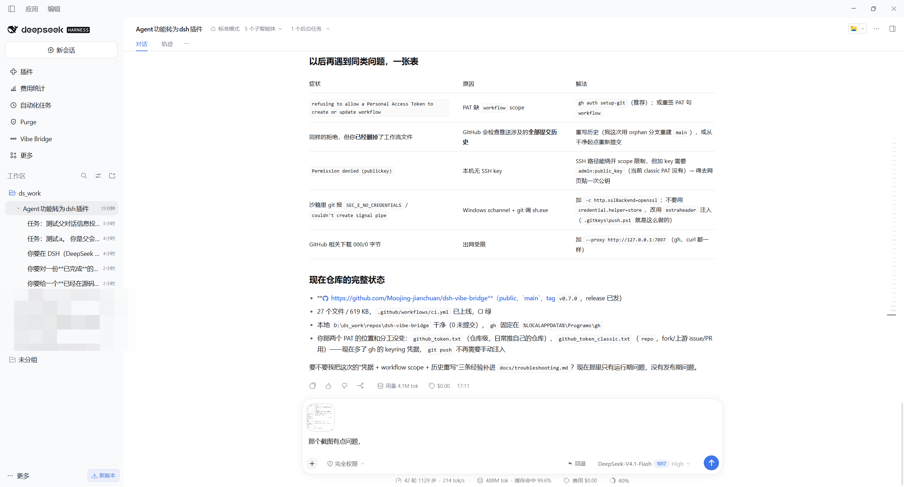
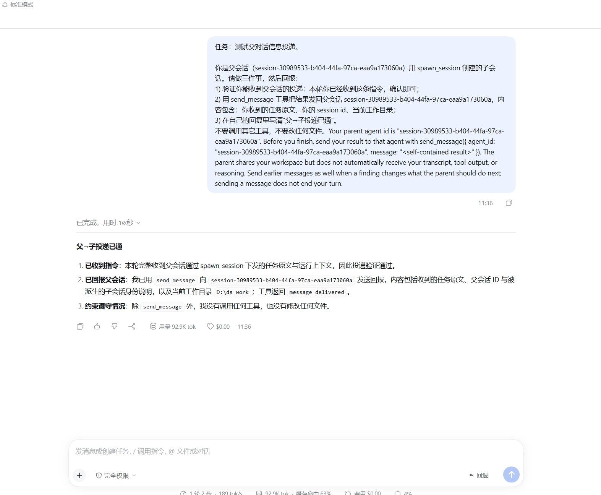
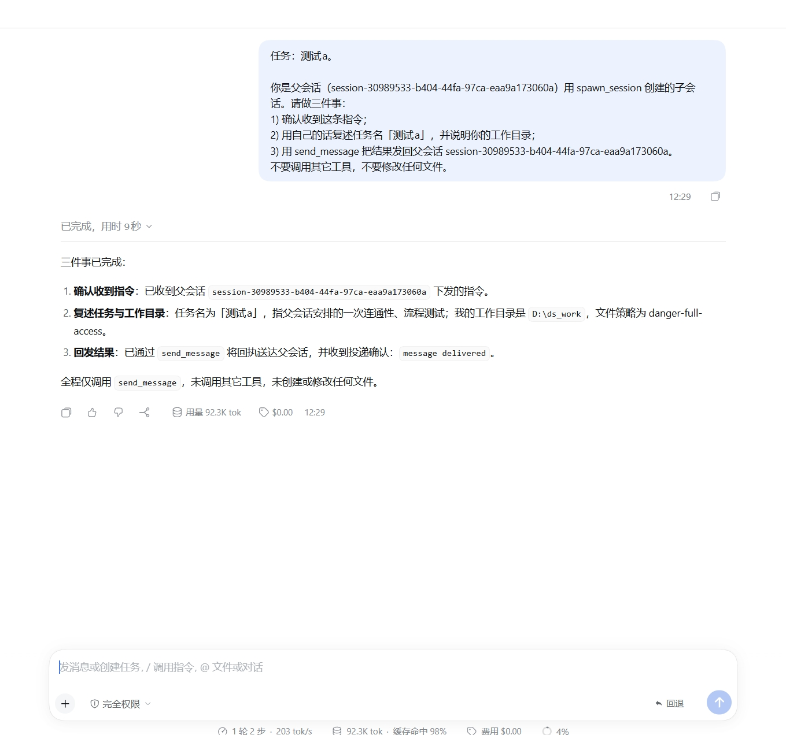

# dsh-vibe-bridge（中文说明）

[English](README.md) · **中文**

给 [DeepSeek Harness](https://github.com/deepseek-ai/deepseek-harness)（DSH）用的插件：把**父子会话**这条链路上缺的三件事补上 —— 不花模型轮次就能建子会话、父会话能读到子会话到底产出了什么、侧栏里能看见这层关系。

> DSH 本来就把"会话血缘"当一等公民：父会话通过 `subagent` 工具派生一个子会话。但周边体验很薄：
> 子会话的 session id 永远到不了父会话手里；侧栏按设计隐藏 `origin: 'subagent'` 的行；
> 也没有便宜的办法问一句"那个子会话到底做了什么"。
> 这个插件用**纯 Cordis 插件**补齐，另外提供一个可选的构建级增强（让子会话行出现在**原生**侧栏里）。



## 实际长什么样

父会话一行，它的子会话往右缩进一格，每个父行自带一个折叠开关（`▾` 展开 / `▸` 收起）。左侧那个 `Vibe Bridge` 入口打开调度台页面：会话树、创建子会话表单、当前生效的碎碎念规则。

子会话是**真正的会话**：点开就是它自己的对话；它每完成一轮，父会话会收到一条带 session id 的通知，不需要再额外调 `list_sessions` 去查 id。

### 细节：子会话到底收到了什么

任务原文直接作为子会话的**第一条用户消息**到达 —— 不是"请你去调 spawn_session 建一个子会话"那种转述。下面这个子会话是从侧栏右键建出来的，14 秒内确认收到，并用 `send_message` 回报父会话：



第二张是父会话真正关心的那一趟往返：子会话复述任务、说明工作目录、把结果发回父会话的 session id —— 一次完成，工具调用在对话里可见：



## 功能一览

| # | 功能 | 实现方式 | 需要可选补丁？ |
|---|---|---|---|
| 1 | **直接建子会话** —— 右键任一会话 →「创建子会话」，或用 `/vibe-spawn 名字\|任务`，或用插件面板 | 注册宿主命令（`ctx.commands.register`）后直接 `startActivation`；子会话收到的第一条消息就是任务原文，不是"请去创建子会话"的转述 | 否 |
| 2 | **父会话拿到子会话 id** —— 每次**被指派的运行**完成一条通知，带 id + 状态，同批合并 | `subagents.startActivation` 配 `delivery: "caller"`，再用 `agent.followup` 投递；合并窗口把同时收工的多个子会话压成一条。只有"本插件建出来的"或"父会话用 `post_to_session` 投过任务的"运行才算指派；你自己在子会话里聊的轮次不会回报父会话 | 否 |
| 3 | **`query_session`** —— 读另一个会话最近几轮 | 流式读 JSONL 会话日志、按魔数切多帧 zstd、渲染轮次与工具摘要 | 否 |
| 4 | **`post_to_session` / `stop_session` / `list_sessions`** | 对 subagent 服务的薄封装 + **投递前先判通信矩阵**（自己的子 ✅ · 父↔父 ✅ · 别人的子 ❌ · 同级兄弟 ❌ · 自己的父 ✅）与 `notify: 'once' \| 'never'`（订一条回执，或投递但不产生任何通知）；`list_sessions(scope: 'workspace')` 读出会话库里每个会话的 `parent_id`/`workdir` | 否 |
| 5 | **投递可见又可审计** —— `query_session` 的 `[inject]` 段、三态重放（`queued`/`consumed`/`dropped`）、`get_session_inbox` 队列视图 | 重放会话日志里的 `agent/inbox/spliced`；不新增事件、不改宿主 | 否 |
| 6 | **轮次碎碎念** | `agent/pre-step` 在指定轮次注入提醒；文案每轮从磁盘重读（改文件即时生效）；连续相同内容折叠成一行标记 | 否 |
| 7 | **唤醒状态落盘** | `<DSH_HOME>/vibe-bridge/wake-state.json`，原子写、12 小时 TTL、启动补偿 | 否 |
| 8 | **原生侧栏里的缩进子行 + 折叠** | 对 `ui-workspace` 的源码补丁 + 自建该包产物 | **是**（实验性，跟版本绑定）|

除第 8 项外都是标准插件。原因很实在：DSH 在会话列表里只声明了 `menu.item` / `row.action` / `row.leading` / `row.hover` 四个插槽，**没有"插入一行"的插槽**，所以纯插件无论如何做不到原生子行 —— 这是接口事实，不是偷懒。

### 哪些运行会回报父会话

子会话只在"父会话要的那一轮"完成时回报：

| 谁发起的这一轮 | 会不会回报 |
|---|---|
| 本插件（`spawn_session`、面板「创建子会话」、`/vibe-spawn`） | 会 —— 该 activation 收尾时回报一次；措辞是**派给你的活** |
| 父会话再给它投任务（`post_to_session`，`notify: 'once'` 默认） | 会 —— 每条消息回报一次：投递时重新 arm，投完的第一次收尾就回报；措辞是**订阅回执** |
| 父会话用 `post_to_session({ notify: 'never' })` 投递 | **不会** —— 只投递不 arm，那条消息不产生任何通知 |
| **你自己**在子会话里打字聊天 | **不会** —— 子会话没被 arm，父会话不受打扰 |
| 子会话回报之后自己继续干活 | 不会 |

这就是 `wake-state.json` 里的 `armed` 标记：插件建子会话或父会话投递时置上，通知入队时清掉，重启补偿也只补"还 armed 且没回报过"的条目。所以打开子会话随便聊不会惊动它的父会话，而真正派下去的活一定会带着 session id 回来。**arm 的原因**（`spawn` / `post`）也一起落盘，所以重启后补发的通知措辞同样正确。

## 安装（插件部分）

```bash
# 1) 一次性指向你的 DSH 安装目录，让测试和安装能解析 @deepseek-ai/*
node tools/dev-link.mjs --dsh "/path/to/dsh"
#    或者：--dsh-node-modules "/path/to/dsh/node_modules"

# 2) 跑契约测试（对着真实服务形状跑，服务改版会当场红）
npm test

# 3) 装进某个 profile（幂等；--uninstall 卸载）
node tools/install.mjs --profile desktop --dsh "/path/to/dsh"
```

`tools/install.mjs` 会把这个包注册进 profile，并把 `@deepseek-ai` 依赖联接到你的 DSH 安装（两半共用同一份模块实例），**在安装位置**跑一遍冒烟测试，最后往 `cordis.patch.yml` 追加插件条目。宿主半需要重启 DSH，客户端半刷新页面。

**务必让 profile 的包管理器来拥有这个包。** 受 pnpm 管理的 profile 会 prune 掉 `package.json` 里没声明的任何 `node_modules` 内容 —— 手工复制进去的 `node_modules/dsh-vibe-bridge` 会在下次 DSH（或其插件管理器）重装时悄悄消失：插件不再被加载，侧栏入口、右键菜单、工具会**同时**整片消失。所以 `tools/install.mjs` 现在会在 profile 有 manifest 时，用 profile 自己的 pnpm 加一条 `link:<本仓库>` 依赖；只有无 manifest 的 profile 才回退到复制。

Windows 上依赖联接用的是目录 junction，不需要管理员权限、也不需要开发者模式。

## 配置

```yaml
- insert:
    - id: vibe-bridge
      name: 'dsh-vibe-bridge'
      config:
        enabled: true
        provider: spawn          # spawn=全新上下文；fork=继承父会话已完成的轮次
        wakeParentOnChildFinish: true
        wakeDebounceMs: 800      # 这个窗口内收工的多个子会话合并成一条通知
        persistWakeState: true   # 重启后仍记得在跑的子会话
        announceChildId: true    # 告诉子会话它自己的 id
        # 顶层节奏标量：设置页编辑的就是这几个键
        everyTurns: 4
        fullEveryTurns: 12
        fromTurn: 1
        skipSubagentSessions: true
        speakOnFirstSeen: true
        nudgeEnabled: true       # 只关碎碎念的总开关（≠ 整插件 enabled）
        nudgeText: ''            # 空 = 回落 rule.file / 包内 nudge.md
        rules:
          - name: verify
            file: '/abs/path/to/nudge.md'   # 每轮重读，改完即时生效
            everyTurns: 4                   # 稀疏提醒的节奏（优先于顶层标量）
            fullEveryTurns: 12              # 全量文案的节奏（优先于顶层标量）
            fromTurn: 1
            skipSubagentSessions: true
            speakOnFirstSeen: true
```

| 键 | 默认 | 含义 |
|---|---|---|
| `rules[].text` / `rules[].file` | — | 内联文本，或每轮重读的文件路径 |
| `rules[].sparseText` | 取全文前 N 行 | 稀疏节奏发的文案 |
| `rules[].everyTurns` / `fullEveryTurns` | （继承顶层标量） | 节奏；`0` 表示不发全量 |
| `everyTurns` / `fullEveryTurns` / `fromTurn` | 4 / 12 / 1 | **顶层节奏标量**：规则没写该字段时用它（设置页编辑的正是这些） |
| `skipSubagentSessions` / `speakOnFirstSeen` | `true` / `true` | 同名字段的顶层默认值 |
| `nudgeText` | `""` | 全局全量文案；空 = `rule.file` → `rule.text`（无 rules 时再回落包内 `nudge.md`） |
| `nudgeEnabled` | `true` | **只关碎碎念**的总开关；`false` 时在会话覆盖之前就短路（任何会话都不注入，`full`/`every:1` 也一样） |
| `wakeDebounceMs` | 800 | 完成通知的合并窗口 |
| `persistWakeState` | `true` | 写 `wake-state.json` 并在启动时补偿 |
| `enableSpawn` / `enableQuery` / `enablePost` / `enableList` / `enableStop` | `true` | 逐工具开关 |
| `enableInbox` | `true` | 注册 `get_session_inbox` |
| `enableNudgeControl` | `true` | 注册 `nudge_control` 与 `/vibe-nudge` 命令 |
| `enableCrossParent` | `true` | 放行 `post_to_session({ cross_parent: true })`（走 sessionController 绕行） |

节奏字段的优先级统一是 **规则内字段 > 顶层标量 > 内置默认**，另有两条兼容规则：

- 规则带了窗口（`toTurn > 0`，或 `fromTurn` 不是 1）却没写节奏时，沿用历史行为「窗内每轮」（1 / 5），老配置一字不变；
- `rules: []` 仍然是「仅工具」，除非你设置了 `nudgeText` 或改过任一顶层标量 —— 那时插件会合成一条名为 `nudge` 的隐式规则。

## 工具

| 工具 | 模型可见的契约 |
|---|---|
| `spawn_session(prompt, label?, cwd?)` | 建子会话，返回 `session started: <childSessionId>` |
| `post_to_session(session_id, message, stop_current?, cross_parent?, notify?)` | 给某个会话投一条消息，但只投通信矩阵允许的格子（自己的子 / 自己的父 / 父↔父）；前缀 `[来自会话 <id> 的消息]`；`stop_current` 先中断正在跑的直接子会话；`cross_parent` 只是父↔父开关（目标必须是顶层会话）；`notify`（默认 `'once'`）订阅对方向下一次收尾的**订阅回执**，`'never'` 只投递不订阅；返回 `{messageId, via, notify}`；别人的子会话、同级兄弟会在投递前被明确拒绝 |
| `list_sessions(scope?)` | `scope: 'children'`（默认）→ `{id, label, status, role: parent\|child}`；`scope: 'workspace'` → 会话库里所有会话，带 `{id, label, status, origin, parent_id?, workdir, workspace}` |
| `query_session(session_id, tail?, include_tools?, verbose?)` | 头部信息 + 最近 `tail` 轮；新增 `[inject]` 段显示别的会话注入的消息；`verbose` 才给模型/供应商/工作目录与更长的正文 |
| `get_session_inbox(session_id)` | 别的会话还没被消费的队列：`{position, target, source_kind, sender_session_id?, queued_at, preview}` |
| `stop_session(session_id)` | 只停自己的直接子会话 |
| `nudge_control(session_id, mode, text?)` | 按会话开关碎碎念：`off` / `sparse` / `full` / `every:N` / `clear`（`on` = clear）/ `purge`；`clear` **只清节奏**、保留本会话文案，`purge` 整条删除；可选 `text` 一次写入本会话文案（`""` = 清空）；返回 `{session_id, mode, source: 'session' \| 'global'}`，重启后仍生效 |
| `vibe_bridge_status()` | 在线状态、规则列表、已注入次数**与字符数**，外加 `overridesCount` 与最多五条 `{sessionId, mode, textCustom, textPreview}`（只有自定义文案的会话，`mode` 报 `global`） |

宿主命令 `/vibe-spawn <名字>|<任务>` 就是界面里「创建子会话」背后的那条路径 —— 所以建子会话不消耗父会话的任何模型轮次。

### 面板布局与碎碎念编辑

左侧栏入口（`Vibe Bridge`）打开的面板，自上而下：

1. **标题 + 描述**，原来的四条「用法」并入描述文字（`spawn_session …`、`list_sessions …`、`post_to_session …`、`vibe_bridge_status …`），不再有独立的「用法」区块。
2. **父对话及其子对话**（只读）：`父对话 <id8> · <标题>`，其下缩进每个子会话 `子会话 <id8> · <label> · <任务描述，截断 40 字>`；数据来自 `listSessions()` 与 `subagentCatalog` 投影。原「父会话 id / 任务」调度台表单已删除。
3. **会话树**：树头放了「创建子会话」（打开的还是那个 `VibeSpawnDialog`，默认父会话取列表里第一个）和「刷新」；每行的 draft 输入 + 发送不变。
4. **这个插件带来什么**：三张卡片改成一段文字。
5. **碎碎念规则**：首行 `全局：开启（每 4 轮）` / `全局：已关闭`，其后逐会话列出实际生效配置，数据来自**一次** `/vibe-nudge status all` 调用 —— `父对话 a1b2c3d4 · 每 4 轮（全局文案）`、`子会话 e5f6a7b8 · 已关闭`、`子会话 … · 每 3 轮（本会话文案）`。没有覆盖的会话显示全局节奏 + “全局文案”；全局关闭时每行统一加 `（全局关闭）`，避免误以为是单会话设置坏了；这里不读也不显示 `cordis.patch.yml`。

**右键任一会话 →「碎碎念编辑」**（子会话行同样有）弹出只作用于该对话的弹窗：

- 标题 `碎碎念 · <id8>`，只读状态行（`生效：全局 / 已关闭 / 稀疏 / 全量 / 每 N 轮 · 文案：全局/本会话`）；全局关闭时显示 `生效：全局已关闭（本会话设置不生效）`；
- **打开** = `/vibe-nudge on`（回落全局），**关闭** = `/vibe-nudge off`，**编辑** 展开多行输入（预填该会话自定义文案，空 = “使用全局文案”），**保存 / 取消**；保存发 `/vibe-nudge text:<base64>`，留空保存 = 清除自定义文案；
- **设置轮次**：`每 [N] 轮` + **应用**（发 `/vibe-nudge every:N`，N 必须是 ≥1 的整数，否则输入框标红且不发送），另有 **稀疏**（`sparse`）与 **全量**（`full`）两个快捷按钮；
- **全局**：`全局：开启/已关闭` + **全局关闭 / 全局开启**。这一项走**设置表单模型**（`edit('nudgeEnabled', …)` + `save()`），与设置卡片同一条通道 —— 客户端从不自己改配置文件；
- 弹窗里有一行 `仅作用于本次对话；子会话同样适用。`，右上角 ✕，点遮罩或按 Esc 也可关闭。

面板与弹窗的会话级改动走 `ctx.remote.commands.execute(会话, 命令, [])`，全局开关走设置表单模型；客户端自身从不读写 `nudges.json`。

### 设置卡片

- **设置 → 插件 → Vibe Bridge** 是一张可编辑卡片：节奏（`everyTurns`、`fullEveryTurns`、`fromTurn`）、全局 `nudgeText`、以及两个布尔项（`skipSubagentSessions`、`speakOnFirstSeen`），带保存/放弃。卡片只在宿主服务本插件命名空间时注册（`configForms.whileServed`）；老版本宿主上退回只读状态行。
- 布尔项用的是**文本框**（`true` / `false`，留空=默认）：宿主提供的字段原语只有文本输入，没有开关控件。
- 表单下方是只读摘要：当前生效节奏 + 有多少会话被单独覆盖。覆盖数来自 `/vibe-nudge status`；拿不到就写“取不到”，不猜。

## 投递可见性：注入段、三态、谁能给谁发、通知来源、workspace 列表

DSH 把每一次 inbox 变更都写进会话日志（`agent/inbox/spliced`）。这就是本插件读的审计流水 —— 不新增事件、不改宿主代码。

### 1. `query_session` 里的 `[inject]` 段

每轮里，**别的会话或运行时**注入的消息会按到达顺序渲染在 `[user]` 与 `[assistant]` 之间：

```
- Inbox: 1 pending, 2 consumed, 1 dropped

--- [inject] 2026-11-12 07:28:11 · agent-message from session-30989533-… · consumed ---
Agent session-30989533-… sent a message: 你的复核报告有用——B1 和 B2 都成立…
    (consumed at 2026-11-12 07:28:44 — drained into the next request)
```

- 行格式固定为 `--- [inject] <时间> · <source.kind>[ from <senderSessionId>] · <状态> ---`；
- 正文默认截到 160 字，`verbose: true` 时 1200 字，截断处用 `…[+N chars]` 说明丢了多少；
- 去重按 **message id**，不按来源类型：凡是 id **没被** `[user]` 段渲染过的，都进这里。原因是同一条消息有两条进请求的路径 —— **运行中**的会话会同时写 `agent/inbox/spliced` 和 `user/message`（`[user]` 段已经显示，`[inject]` 跳过）；而**冷会话/被 resume 的会话**可以直接由 splice 喂进请求，日志里**根本没有** `user/message` 事件。早期按来源过滤会把后一种整条抹掉，正是本功能要消灭的「发了看不到」；
- `tail` / `include_tools` / `verbose` 的语义没变；头部那行统计的是 `[inject]` 段里的条目，所以可能包含 `user` 来源（冷会话那类）；
- 去重只认 `[user]` 段**真会渲染**的那批 `user/message`（`source.kind` 缺失或为 `'user'`）。`agent-message` / `agent-instructions` / `vibe-bridge` 同样会被写成 `user/message` 事件，但 `[user]` 段不渲染它们 —— 按「事件存在」去重会把它们从报告里删掉，而不是避免重复。

### 2. 投递三态 + `get_session_inbox`

重放 splice 之后，每条注入都落进三个状态之一：

| 状态 | 日志里的判据 | 含义 |
|---|---|---|
| `queued` | 插入后从未被移除 | 还在队列里，没人消费 |
| `consumed` | 被移除且 `removedCount > 0`、没有 `outcome` | 被下一轮请求取走（`Inbox.claim()`） |
| `dropped` | 被移除且 `outcome: 'canceled'` | 消费前被取消 / `clear()` / 被中断 |

`get_session_inbox(session_id)` 只列仍然 `queued` 的条目，带队列位置、`next-turn`/`next-step` 目标、来源类型、发送方 session id（来源里有的话）与入队时间；目标空闲或不在内存里时，`note` 会明说。
**pending 永远不会被谎报成 consumed** —— 目标被中断后，日志没有记录移除之前，它一直显示 `queued`。

**`pending: 0` 是正常的健康应答。** 运行中（或刚 resume）的会话会在下一个 step 开头把队列取走，所以一条投递往往几秒内就变 `consumed` —— 要看「投过什么」请用 `query_session`，头部 `- Inbox:` 行和 `[inject]` 段才是长期留存的那份记录。只有**再也不会启动**的会话会让条目长期停在 `queued`（真实离线会话上验证过：一条消息从 2026-11-11 一直 `queued`）。所以 `pending: 0` 从不表示「没投递成功」，它表示「此刻没有在排队的」。

口径提醒：头部那行统计 `[inject]` 段里的条目，而 `get_session_inbox` 列的是原始队列 —— 一条人类提示可能两处都有、只有一处、或（已被目标取走时）都没有。

### 3. 谁能给谁发（`post_to_session` 的判定规则）

`post_to_session` 不再是「先试后失败」：它**先读双方会话头**（和 workspace 列表同一套「日志首条 `session` 事件」轻量读法），按通信矩阵判定，然后才投递。被拒绝的那一格**不会**调用 `subagents.sendMessage`、**不会**碰 sessionController、也没有任何副作用：

| 发送方 | 接收方 | 结果 | 谁保证 |
|---|---|---|---|
| 父会话 | **自己的**子会话 | ✅ 投递，`via: 'subagent'`，durable `agent-message` 归因（`source.kind` + `senderSessionId`） | 插件预判 + DSH lineage（两道一致） |
| 父会话 | 另一个**顶层**会话（父↔父） | ✅ 投递，`via: 'controller'`，归因降级为正文前缀 `[来自会话 <id> 的消息]` | 插件预判 + `sessionController.prompt`（无 lineage 校验） |
| 父会话 | **别人的**子会话 | ❌ 投递前就明确拒绝：`post_to_session: 目标是别的父会话的子会话（<id>，属 <parentId>）…` | 插件预判；DSH `authorizeLineage` 本来也会拒 |
| 子会话 | **同级兄弟**子会话 | ❌ 同样明确拒绝（子会话之间含兄弟互不投递） | 插件预判；DSH lineage 本来也会拒 |
| 子会话 | **自己的**父会话 | ✅ 投递 —— 回报通道，`via: 'subagent'`（只有消息通道被判血缘时才用 controller） | 插件预判 + DSH lineage |

```jsonc
// 自己的子会话 / 自己的父会话 —— 来源保真
{ "messageId": "…", "via": "subagent" }
// 父↔父（目标是顶层会话）—— 投进去了，但来源只剩正文前缀
{ "messageId": "controller-…", "via": "controller" }
```

判定顺序：

- 目标 `origin !== 'subagent'`（顶层）：父↔父走 controller；**子会话**发送时，只有目标正是它自己的父会话才允许，其它顶层目标一律拒绝；
- 目标 `origin === 'subagent'` 且 `parentSession === 调用方` → 走 subagent 消息通道（行为不变）；
- 目标 `origin === 'subagent'` 且 `parentSession !== 调用方` → 投递前拒绝（包含同级兄弟）；
- 目标日志读不到（还没落盘）→ 判不了，保留 0.10 之前的老行为：先试 `sendMessage`，只有血缘拒收且 `cross_parent: true` 时才试 controller。

`cross_parent` 名字保留，但**只用于父↔父**：它永远解不开 subagent 目标。省略该参数即允许父↔父；显式传 `cross_parent: false` 表示「不离开自己的血缘」，此时顶层目标会被明确拒绝并提示去掉该参数。

controller 写死 `source.kind = 'user'`，所以父↔父消息靠正文前缀 `[来自会话 <senderId> 的消息]` 表明来路。投给**冷会话**时它只出现在 `[inject]` 段（没有 `user/message` 事件）；投给会写 `user/message` 的会话时出现在 `[user]` 段 —— 两种情况都看得见。
`via` 就是那句实话：`controller` 表示日志里的发送方不可信，只有前缀可信。`stop_current` 语义不变。

**为什么「父→别人的子会话」连绕过预判也走不通：** 这条路必须借 sessionController，而 controller **无条件拒绝解析 subagent 来源的会话**：

- `packages/api/session-controller/src/agent.ts:115` —— `hasApiSessionSubagentOwner` 对 `session.header.origin === 'subagent'` 直接返回 `true`，于是 `resolve()` 抛 `session/agent-busy`，`commands.prompt` 在 `resolveAgent` 就挂了，根本走不到 `followup()`。

这是 DSH 核心的设计取舍（子会话没有「API owner」），插件层绕不过去 —— 插件可用的写入通道只有这一条。
要开启这一格，需要上游改动：要么放宽 `authorizeLineage`（`packages/subagent/subagent/src/manager.ts:713-722`）允许显式授权的非祖先发送方，要么让 controller 对经认证的调用方解开 `origin: 'subagent'` 的解析限制。

### 4. 完成通知：派单 vs 订阅

一条完成通知是**对方那一轮的收据**，不是"它为你干了活"的宣告。插件记下自己**为什么** arm 那个会话，并据此决定措辞，让这两件事不再长得一样：

| arm 原因 | 谁置上的 | 通知措辞 |
|---|---|---|
| `spawn`（派单） | `spawn_session`、面板「创建子会话」、`/vibe-spawn` | `会话「…」完成了新一轮工作。` —— 这一轮**就是**你派下去的活 |
| `post`（订阅） | `post_to_session` 且 `notify: 'once'`（默认） | `会话「…」…这一条是 post_to_session 的订阅回执 —— 只表示它跑完了一轮，不代表这一轮是为你那条消息专门做的，也不代表你收到了它的全部工作。` |

为什么必须区分：你投给一个**顶层对等会话**之后，它仍在做自己的事，于是它每一轮收尾都会回一条"完成了新一轮工作"—— 跟你派下去的活长得一模一样，看起来就是噪音。
`notify: 'once'` 只给一条回执（投递后第一次收尾），之后不再打扰；`notify: 'never'` 连 arm 都不做，那条消息不产生任何通知，也不会改动已有的通知状态。

合并通知沿用同一套区分：只有一个子会话时用上面的措辞；合并时在被订阅的子会话后面标 `（订阅回执）`，若派单与订阅结果落在同一个合并窗口里，首行会写 `含 N 条订阅回执`。arm 原因会落盘进 `wake-state.json`，所以重启补偿补发的通知措辞同样正确。

### 5. `list_sessions(scope: 'workspace')`

`scope: 'workspace'` 扫 `<DSH_HOME>/sessions/*/*`，读每个日志的**第一条事件**（`type: 'session'`）—— `parentSession` / `cwd` / `origin` / `delegationDepth` 都只写在那里，`request/header` 里没有。
每个日志只读、只解开头 256 KB，所以 80 个会话的完整列表也在 1 秒内。

```
d2a74178-… [running] (child of session-30989533-…) — 实现 R1-R4 会话通信改造  ·  D:\ds_work  ·  --D-ds_work--
a1f82c62-… [inactive] (top-level) — 重建工作区  ·  D:\ds_work  ·  --D-ds_work--
```

`status` 在 Agent 仍注册于 `ctx.agents` 时是 `running` / `inactive`，否则是 `not-loaded`（重启后、或属于别的进程）—— 这描述的是注册表事实，不是会话本身状态。
自己所在 workspace 的行排在最前，其次新的在前。要拿「不是自己子会话」的 id 去跨父投递，就用这个列表查。

### 6. 按会话注入（`nudges.json`）

节奏是全局的；单个会话可以单独关掉、换节奏，**或者带一份自己的文案**，都不用改配置：

```jsonc
// $DSH_HOME/vibe-bridge/nudges.json —— 原子写；每次 pre-step 读（按 mtime 缓存）
{ "session-abc": { "mode": "off", "text": "这篇先别催我", "updatedAt": "2026-11-25T04:57:39.052Z" } }
```

| 字段 | 对该会话的效果 |
|---|---|
| `mode: "off"` | 完全不注入 |
| `mode: "sparse"` | 只在全局判定为「稀疏」的轮次注入 |
| `mode: "full"` | 每轮注入全量文案 |
| `mode: "every:N"` | 第 1、1+N、1+2N… 轮注入全量文案 |
| 没有 `mode` | 按全局规则 |
| `text` | 该会话自己的全量文案（空值 = 没有自定义文案） |

文案优先级：**会话 `text` > `nudgeText` > `rule.file` > `rule.text` > 包内 `nudge.md`**；节奏优先级仍是 **会话 `mode` > `rules[]` > 顶层标量 > 默认**。`off` 只抑制注入，盘上的 `text` 会保留，重新打开不会丢。子会话完成通知不受影响。

三个入口写的是同一个文件，所以重启后依然生效：

- `nudge_control(session_id, mode, text?)`（模型工具）—— `text` 可以一次把文案也写进去；
- 宿主命令 `/vibe-nudge …`：`off` | `on` | `sparse` | `full` | `every:N` | `clear` | `purge`（无参 = 在 `off` ↔ 全局之间切换），`text:<base64>` 设置本会话文案（`text:` 清空），`status` 给单个会话（`every … · global on|off` / `rules: …` / `overrides: …` 外加一行 `session: mode=… text=<base64|empty>` 供弹窗预填），`status all` 给面板（首行 `global: on|off · every N · full M · from K`，之后每个有覆盖的会话一行 `<id>: <mode> text=yes|no`）；
- 右键「碎碎念编辑」弹窗（见上）。

`clear` 与 `purge` 是刻意分开的：

| 命令 | 对 `nudges.json` 的影响 |
|---|---|
| `clear`（或 `on`） | **只删 `mode`**；已存的自定义文案保留，重新开启不丢。若原本只有 `mode`、没有文案，则整条消失（不留空壳）。 |
| `purge` | 整条删除，自定义文案一并丢弃。 |

弹窗的「打开」就是 `on`（= clear），所以关一次再开回来不会丢文案。

`nudges.json` 坏掉或读不到时一律当空表处理（只记一次 `warn`，**绝不**让 `agent/pre-step` 抛错），所以手改成坏文件也不会卡住一轮。

## 上下文成本（实测）

在一条 19 轮的父会话上量的（只算模型可见的 `content` 文本，不重复计 `source.sections` 那份副本）：

| 项 | 0.6.0 之前 | 之后 |
|---|---|---|
| 注入的提醒条数 | 12 | 12（节奏完全不变）|
| 注入字符 | 2,501 | 预期约 1.2k —— 相同内容折叠成一行标记 |
| 占 user 侧内容比例 | **54 %** | 约减半 |
| `query_session` 报告长度 | 938 字符（verbose 形态）| 默认 818，`verbose: true` 才 938 |
| 5 个子会话的完成通知 | 5 条 | **1** 条合并 |
| `announceChildId` | 180 字符 | 96 字符 |

碎碎念**仍然以可见的用户消息出现**，这是刻意的：搬进 system prompt 更省 token，但那会把"看得见的提醒"降级成"看不见的规则"，属于功能打折。

## 可选：原生侧栏里的子会话行

```bash
# 1) 拿到补丁对应的 DSH 源码
git clone --depth 1 --branch dsh-v0.2.1-rc.5 https://github.com/deepseek-ai/deepseek-harness.git
cd deepseek-harness

# 2) 应用补丁并构建这个包的产物
git apply -p1 /path/to/dsh-vibe-bridge/tools/source-patch/nested-sessions.patch
pnpm install
pnpm run build:artifacts

# 3) 把构建出来的那一个 bundle 装进你的 DSH（原产物留作备份）
node /path/to/dsh-vibe-bridge/tools/install-bundle.mjs \
  --bundle packages/client/ui-workspace/lib/client.js \
  --dsh-node-modules "/path/to/dsh/node_modules"

# 随时回退
node /path/to/dsh-vibe-bridge/tools/install-bundle.mjs --restore --dsh-node-modules "…"
```

补丁到底做了什么（7 个源码文件 + 3 个测试文件，外加 README 及其 i18n 记录）：

- 子行缩进挂在父行正下方，标题优先取**实时**会话标题（重命名立即生效）→ catalog label → id 前 8 位；
- 每个父行一个折叠键 `session:<parentId>`，**默认展开**，可访问名走 locale 字典；
- 子行不占水位线、不可拖拽；
- **子行只带一个行动作：归档 / 恢复**，走它自己的列表槽 `sidebar.workspaces.session.childRow.action`。子行不渲染菜单，所以重命名、pin、fork 都不会落到它身上；普通行的 action 列表也不渲染给子行，避免 pin 按钮出现在点不动的行上。归档正在跑的子会话仍会走"先停再归档"确认；
- 归档过滤器对子行与父行一视同仁，唯一例外是「仅归档」视图仍列出归档父行的归档子行 —— 因为那个视图正是恢复归档会话的入口；
- 选中的是子行时，它的父行会被算作注意力目标，即使父行处于折叠状态也不会被水位线裁掉。

在 `dsh-v0.2.1-rc.5` 上验证过：`pnpm run typecheck`（5 个 gate）、`pnpm run build:artifacts`（7 个 gate / 327 个产物）、`packages/client/ui-workspace` 的 vitest（**495 个测试**）、`tree.ts / stores.ts / Rows.tsx / locales.ts` 逐文件覆盖率 **100 %**、`verify-client-ui-i18n`、`verify-export-jsdoc`、`verify-md-wrap`、`verify-translation-pairing` 全绿。

> **这一半是实验性的、跟版本绑定的。** 它改的是构建产物、碰的是内部形状。DSH 升级可能让它失效；失效时插件本体（1–6 项）照常工作，只是原生子行退化成插件自己的面板树。仓库里的 `tools/legacy-dist-patch.mjs` 是同一思路更早的纯文本补丁版本，留作参考；检测到源码版已安装时它会拒绝执行。

## 兼容性

| 组件 | 版本 |
|---|---|
| DSH | `0.2.1-rc.5`（源码补丁基于 `dsh-v0.2.1-rc.5` 生成）|
| Node | `>= 22.19` |
| 系统 | Windows（依赖联接用 junction）、macOS、Linux |

升级 DSH 时：先重跑 `tools/install.mjs`（插件半对版本不敏感，除非服务形状变了 —— 契约测试会当场告诉你），如果你用了侧栏增强，再重新构建并应用源码补丁。补丁打不上就带版本号开 issue，diff 很小，重基成本低。

## 已知限制

- **DSH 没有"行插槽"** —— 这正是需要源码补丁的唯一原因；任何宣称纯插件能做到原生嵌套行的说法都是错的。
- **会话间通信不是随便发** —— 自己的子 ✅、自己的父 ✅、父↔父 ✅；别人的子会话与同级兄弟在投递前就被拒绝，插件层没有任何开关能改这一点（controller 不解析 subagent 来源的会话，见第 3 节）。
- `query_session` 读的是**日志**而不是内存：正在跑但还没落盘的轮次只能看到已经写入的部分。
- **被拒绝不等于被丢掉**：被拒的 `post_to_session` 会带着原因抛错，目标日志里不留任何痕迹 —— 这正是"投递前先判"而不是"投到一半才失败"的意义。
- 重启补偿是**推断**：重启后插件只知道"这个子会话不在跑了"，拿不到真实收尾原因。DSH 停机期间被杀掉的子会话会被报成"已完成"。
- 子行只列 `continuable` 子会话；`external`（一次性 ACP）子会话没有可恢复的会话可打开。
- 在 DSH 源码仓库里跑 `pnpm run test:gui`，Windows 上会有与本插件无关的红（`ui-deliverables` 需要符号链接权限；另两条在并行负载下不稳定，单独跑通过）。详见 [docs/troubleshooting.md](docs/troubleshooting.md)。

## 卸载

```bash
node tools/install.mjs --uninstall --profile desktop
node tools/install-bundle.mjs --restore --dsh-node-modules "/path/to/dsh/node_modules"
```

## 仓库结构

```
lib/index.js                 宿主半：工具、碎碎念、完成唤醒、唤醒状态落盘
lib/client.js                客户端半：侧栏入口、面板会话树、创建子会话弹窗
nudge.md                     默认碎碎念文案（每轮重读）
test/                        宿主契约 27 项、客户端契约 16 项、落盘探针 4 项
tools/install.mjs            装进 profile（幂等，并在安装位置跑测试）
tools/install-bundle.mjs     装/回滚可选的侧栏产物
tools/dev-link.mjs           把 DSH 的 @deepseek-ai/* 联接到本包，便于本地跑测试
tools/source-patch/          对 DSH `ui-workspace` 的 unified diff
tools/legacy-dist-patch.mjs  已退役的纯文本补丁器（仅作参考）
docs/                        截图、故障排查、维护指南
```

## 许可

MIT，见 [LICENSE](LICENSE)。本仓库**不打包** DSH 的源码或构建产物，只提供补丁与安装器；署名与商标说明见 [NOTICE](NOTICE)。
