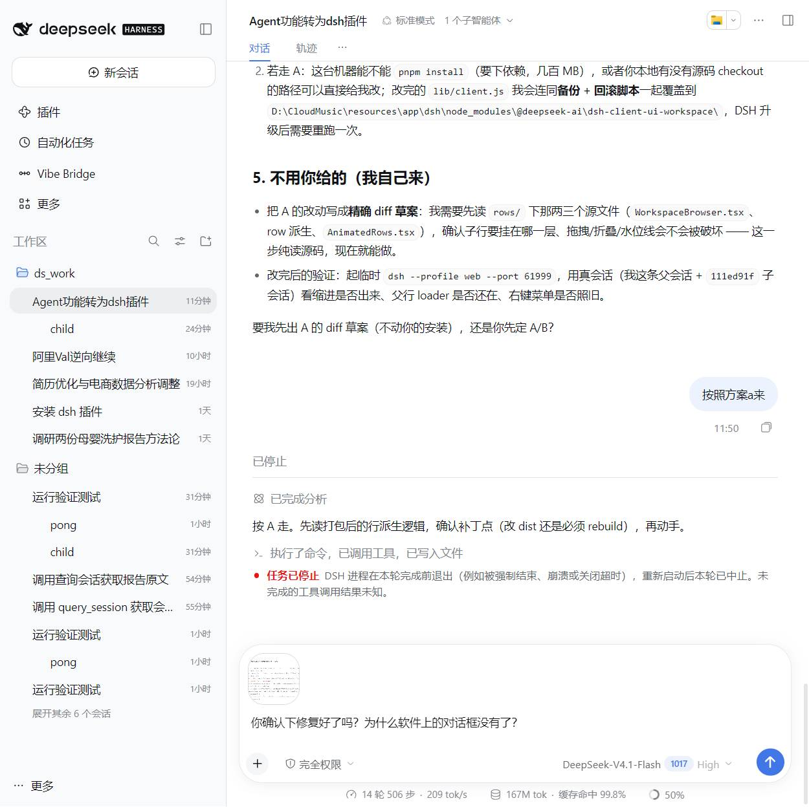

# dsh-vibe-bridge（中文）

[DeepSeek Harness](https://github.com/deepseek-ai/deepseek-harness)（DSH）插件：把**父子会话**这条链路上缺的三件事补上 —— 不花模型轮次就能建子会话、父会话能读到子会话到底做了什么、侧栏里能看见这层关系。

> DSH 本身把「会话血缘」当一等公民：父会话通过 `subagent` 工具派生子会话。但周边体验很薄：子会话的 session id 永远到不了父会话手里；侧栏按设计隐藏 `origin: 'subagent'` 的行；也没有便宜的办法问一句"那个子会话到底产出了什么"。这个插件用**纯 Cordis 插件**的方式补齐，另外提供一个可选的构建级增强。



## 功能一览

| # | 功能 | 实现方式 | 需要可选补丁？ |
|---|---|---|---|
| 1 | **直接建子会话**：右键会话 →「创建子会话」、`/vibe-spawn 名字\|任务`、或插件面板 | 注册宿主命令（`ctx.commands.register`）后直接 `startActivation`；子会话收到的第一条消息就是任务原文 | 否 |
| 2 | **父会话拿到子会话 id**：每个子会话完成一条通知，带 id 与状态，同批合并 | `delivery: "caller"` + `agent.followup`，加合并窗口 | 否 |
| 3 | **`query_session`**：读另一个会话最近几轮 | 流式读 JSONL 会话日志、按魔数切多帧 zstd、渲染轮次与工具摘要 | 否 |
| 4 | **`post_to_session` / `stop_session` / `list_sessions`** | 对 subagent 服务的薄封装 + 父子角色校验 | 否 |
| 5 | **轮次碎碎念** | `agent/pre-step` 在指定轮次注入提醒；文案每轮从磁盘重读；相同内容折叠成一行标记 | 否 |
| 6 | **唤醒状态落盘** | `<DSH_HOME>/vibe-bridge/wake-state.json`，原子写、12 小时 TTL、启动补偿 | 否 |
| 7 | **原生侧栏里的缩进子行 + 折叠** | 对 `ui-workspace` 的源码补丁 + 自建该包产物 | **是**（实验性，跟版本绑定）|

除 #7 外都是标准插件。原因很实在：DSH 在会话列表里只声明了 `menu.item` / `row.action` / `row.leading` / `row.hover` 四个插槽，**没有"插入一行"的插槽**，所以纯插件做不到原生子行 —— 这不是偷懒，是接口事实。

## 安装（插件部分）

```bash
# 1) 一次性指向你的 DSH 安装目录，让测试与安装能解析 @deepseek-ai/*
node tools/dev-link.mjs --dsh "/path/to/dsh"
#    或： --dsh-node-modules "/path/to/dsh/node_modules"

# 2) 跑契约测试（对着真实服务形状跑）
npm test

# 3) 装进某个 profile（幂等，--uninstall 卸载）
node tools/install.mjs --profile desktop --dsh "/path/to/dsh"
```

`tools/install.mjs` 会把包复制到 `<DSH_HOME>/profiles/<profile>/node_modules/dsh-vibe-bridge`，把 `@deepseek-ai` 依赖联接到你的 DSH 安装（两半共用同一份模块实例），**在安装位置**跑一遍冒烟测试，最后往 `cordis.patch.yml` 追加插件条目。宿主半需要重启 DSH，客户端半刷新页面。

## 配置

```yaml
- insert:
    - id: vibe-bridge
      name: 'dsh-vibe-bridge'
      config:
        enabled: true
        provider: spawn          # spawn=全新上下文；fork=继承父会话已完成的轮次
        wakeParentOnChildFinish: true
        wakeDebounceMs: 800
        persistWakeState: true
        announceChildId: true
        rules:
          - name: verify
            file: '/abs/path/to/nudge.md'
            everyTurns: 4
            fullEveryTurns: 12
            fromTurn: 1
            skipSubagentSessions: true
            speakOnFirstSeen: true
```

## 上下文成本（实测）

19 轮父会话，只算模型可见的 `content` 文本：

| 项 | 0.6.0 之前 | 之后 |
|---|---|---|
| 注入条数 | 12 | 12（节奏不变）|
| 注入字符 | 2,501 | 预期约 1.2k（同文折叠成标记）|
| 占 user 侧比例 | **54 %** | 约减半 |
| `query_session` 报告 | 938 字符（verbose 形态）| 默认 818，`verbose: true` 才 938 |
| 5 个子会话完成通知 | 5 条 | **1** 条合并 |
| `announceChildId` | 180 字符 | 96 字符 |

碎碎念仍然**是可见的用户消息**——搬进 system prompt 更省 token，但那会把"看得见的提醒"变成"看不见的规则"，属于功能打折，所以没做。

## 可选：原生侧栏里的子会话行

```bash
git clone --depth 1 --branch dsh-v0.2.1-rc.5 https://github.com/deepseek-ai/deepseek-harness.git
cd deepseek-harness
git apply -p1 /path/to/dsh-vibe-bridge/tools/source-patch/nested-sessions.patch
pnpm install && pnpm run build:artifacts
node /path/to/dsh-vibe-bridge/tools/install-bundle.mjs \
  --bundle packages/client/ui-workspace/lib/client.js \
  --dsh-node-modules "/path/to/dsh/node_modules"
# 回退
node /path/to/dsh-vibe-bridge/tools/install-bundle.mjs --restore --dsh-node-modules "…"
```

补丁做了什么（6 个源码文件 + 3 个测试 + README 及其 i18n 记录）：子行缩进挂在父行下、标题优先取实时会话标题、每个父行一个折叠键 `session:<parentId>`（默认展开）、子行不占水位线/不可拖拽/无行菜单/双击不改名、归档过滤对子行与父行一致（唯一例外：仅归档视图保留"归档父行的归档子行"，因为那是恢复入口）、选中子行时父行留在水位线内。

> **这一半是实验性的、跟版本绑定的。** 它改的是构建产物、碰的是内部形状。DSH 升级可能让它失效；失效时插件本体（1–6）照常工作，只是原生子行退化成插件自己的面板树。

## 兼容性

| 组件 | 版本 |
|---|---|
| DSH | `0.2.1-rc.5`（源码补丁基于 `dsh-v0.2.1-rc.5`）|
| Node | `>= 22.19` |
| 系统 | Windows / macOS / Linux |

## 已知限制

- **没有行插槽** —— 这正是需要源码补丁的唯一原因；宣称纯插件能做到原生嵌套行都是错的。
- `query_session` 读的是**日志**不是内存：正在跑但还没落盘的轮次只能看到已写入的部分。
- 重启补偿是**推断**：重启后插件只知道"子会话不在跑了"，拿不到真实收尾原因。
- 子行只列 `continuable` 子会话；`external`（一次性 ACP）没有可恢复的会话。

## 卸载

```bash
node tools/install.mjs --uninstall --profile desktop
node tools/install-bundle.mjs --restore --dsh-node-modules "/path/to/dsh/node_modules"
```

## 许可

MIT，见 [LICENSE](LICENSE)。本仓库**不打包** DSH 的源码或构建产物，只提供补丁与安装器；署名与商标说明见 [NOTICE](NOTICE)。
